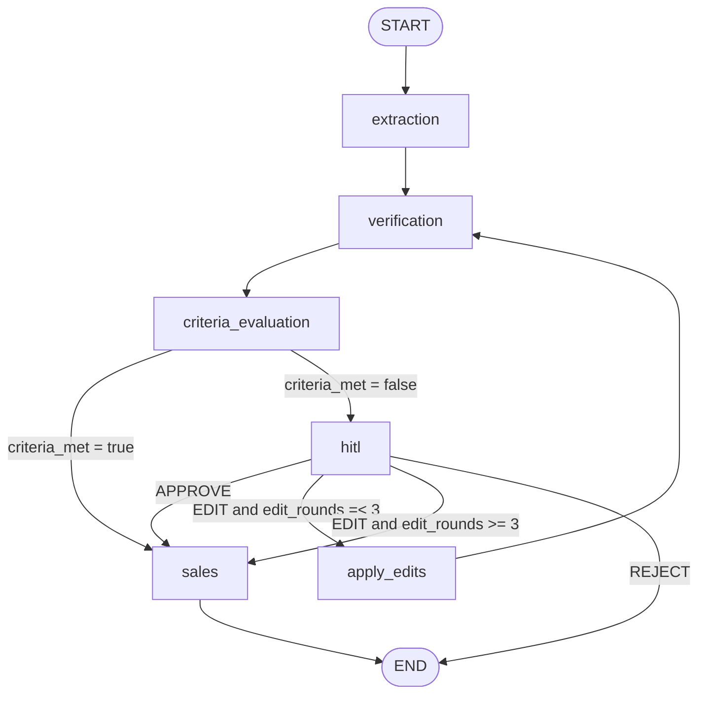
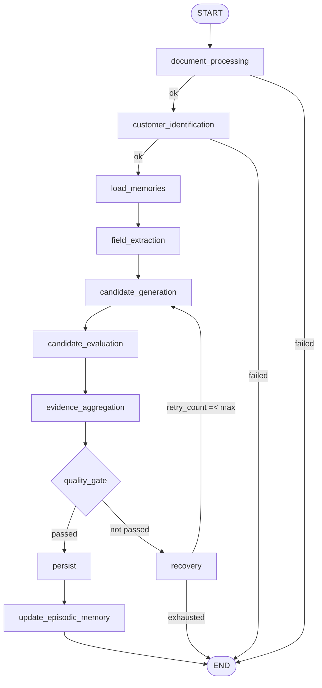
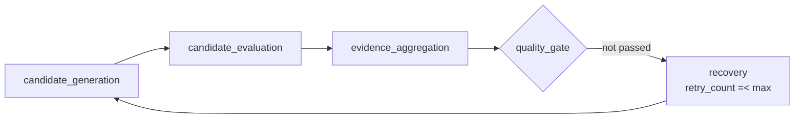
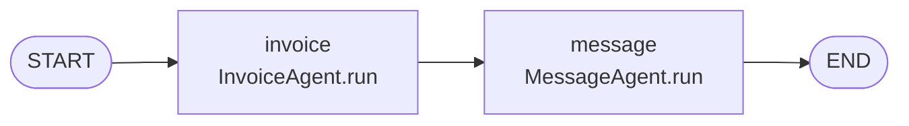
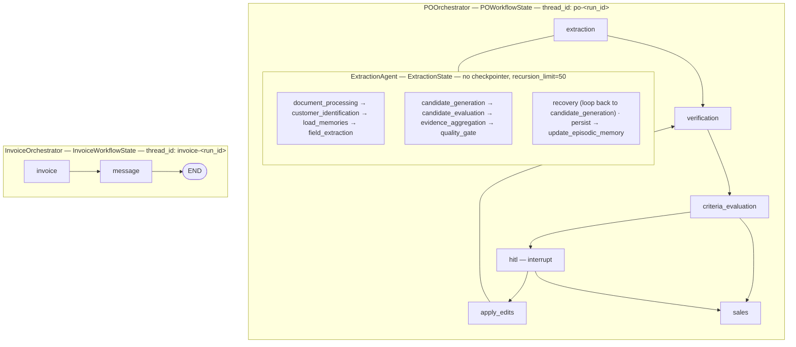

# PO-In Python Service — LangGraph Workflows

Reference for the three LangGraphs owned by the Python agent service:

| Graph | Class | State schema | File |
|---|---|---|---|
| Purchase Order | `POOrchestrator` | `POWorkflowState` | `app/orchestrator_service/po_orchestrator.py` |
| Extraction (subgraph) | `ExtractionAgent` | `ExtractionState` | `app/agents/extraction_agent.py` |
| Invoice | `InvoiceOrchestrator` | `InvoiceWorkflowState` | `app/orchestrator_service/invoice_orchestrator.py` |

Shared base: `BaseOrchestrator` (`app/orchestrator_service/base_orchestrator.py`)
— `compile()` (once, with checkpointer), `invoke(state, thread_id)`,
`resume(thread_id, Command(resume=...))`, `get_state(thread_id)`.

---

## 1. POOrchestrator

### 1.1 Graph



Built by `POOrchestrator._build_graph()` (`po_orchestrator.py:228`).

### 1.2 Nodes

| Node | Function | Writes to state |
|---|---|---|
| `extraction` | `POOrchestrator._extraction_node:73` → `ExtractionAgent.execute` | `extraction_result, extracted_header_fields, extracted_line_item_fields, extracted_po, po_total_amount, current_step, status, extraction_error, extraction_error_code, file_bytes=None` |
| `verification` | `VerifierAgent.run` (LLM agent) | `verification_result, criteria_met, hitl_required, hitl_context, current_step="verification", status="RUNNING"` |
| `criteria_evaluation` | `POOrchestrator._evaluate_criteria:93` | `criteria_met, hitl_required = not criteria_met, current_step="criteria_evaluation", status="RUNNING"` |
| `hitl` | `POOrchestrator._hitl_node:113` | `hitl_decision, current_step="hitl", status="WAITING_FOR_HUMAN"` |
| `apply_edits` | `POOrchestrator._apply_edits:139` | `extracted_po, po_total_amount, edits_applied=True, edit_rounds, criteria_met=False, hitl_required=False, verification_result=None, current_step="apply_edits"` |
| `sales` | `SalesAgent.run` (LLM agent) | `po_id, sale_id, sale_status, source_file_url, current_step="sales", status="COMPLETED"` |

### 1.3 Edges

```text
add_edge(START,            "extraction")
add_edge("extraction",     "verification")
add_edge("verification",   "criteria_evaluation")
add_conditional_edges("criteria_evaluation", _route_from_criteria, {sales, hitl})
add_conditional_edges("hitl",              _route_from_hitl,      {approve, reject, edit})
add_edge("apply_edits",    "verification")     # re-verification loop
add_edge("sales",          END)
```

### 1.4 Routing functions

Both are pure — they read state, return a route key, and only log.

`_route_from_criteria` (`po_orchestrator.py:195`)

```python
return "sales" if state.get("criteria_met") else "hitl"
```

`_route_from_hitl` (`po_orchestrator.py:205`)

```python
decision = (state.get("hitl_decision") or {}).get("decision")
if decision == "EDIT":
    return "approve" if int(state.get("edit_rounds") or 0) >= MAX_EDIT_ROUNDS else "edit"
if decision == "REJECT":
    return "reject"
return "approve"          # APPROVE, or anything unknown
```

`MAX_EDIT_ROUNDS = 3` (`po_orchestrator.py:29`) — after three edit rounds the graph
force-routes to `sales` instead of looping back to `verification`.

### 1.5 `criteria_evaluation`

```python
criteria_met = bool(state.get("criteria_met", verification.get("has_blocking_issues", True) is False))
```

`VerifierAgent._map_update` already computes `criteria_met = not has_blocking_issues`,
so this node normally just echoes it. It exists as a separate seam for routing.

### 1.6 `apply_edits`

- Whitelist `_EDITABLE_FIELDS` (`po_orchestrator.py:31`): `po_number, customer, gst_no,
  ship_to, address_1, address_2, city, state, country, zip`. Unknown keys are collected
  and logged as `ignored_fields`; they do **not** stop the workflow.
- `line_items` may be replaced wholesale when the change value is a list.
- `po_total_amount` is recomputed as `round(Σ(unit_price × quantity), 2)`.
- `edit_rounds += 1`; `verification_result` is cleared and `criteria_met` forced to
  `False` so the PO is re-verified from scratch after edits.

### 1.7 HITL interrupt

`_hitl_node` is the graph's pause point:

```python
decision = interrupt({
    "question": "purchase_order_review",
    "run_id": state.get("run_id"),
    "context": state.get("hitl_context") or {},
})
return {"hitl_decision": decision, "current_step": "hitl", "status": "WAITING_FOR_HUMAN"}
```

The graph returns a result containing `__interrupt__`; `AgentService` persists the run
as `WAITING_FOR_HUMAN` and stores the payload in `agent_runs.hitl_context`.
Resume is `Command(resume={decision, changes, reason, submitted_at})` on the **same**
`thread_id` (`po-{run_id}`), so the Postgres checkpointer continues at `hitl`.

### 1.8 State — `POWorkflowState`

```text
identity      run_id, thread_id, workflow
document      file_bytes, file_name, mime_type, source_file_url
extraction    extracted_po, po_total_amount, extracted_header_fields,
              extracted_line_item_fields, extraction_result,
              extraction_error, extraction_error_code
verification  verification_result, criteria_met, hitl_required, hitl_context
HITL          hitl_decision, edits_applied            (+ edit_rounds written by apply_edits)
outcome       po_id, sale_id, sale_status
lifecycle     status, current_step, workflow_error
```

---

## 2. ExtractionAgent (subgraph)

Invoked as a single node of the PO graph (`_extraction_node`). Owns its own
`StateGraph(ExtractionState)`, compiled **without** a checkpointer
(`extraction_agent.py:423`) and invoked with `recursion_limit=50`.

### 2.1 Graph



### 2.2 Nodes

| Node | Function | Purpose |
|---|---|---|
| `document_processing` | `_node_document_processing:507` | Bedrock OCR → `document_text`, `document_lines` (`headerLines` + `lineItemLines`) |
| `customer_identification` | `_node_customer_identification:570` | Candidate agent for `customer` + `gst_no`, then `lookup_customer`; on miss delegates to `_resolve_customer_not_found:610` |
| `load_memories` | `_node_load_memories:714` | `lookup_field_definitions(scope="all")` + static baseline from `prompts/memory.yaml` + per-field `get_episodic_memory(customer_id, field)` |
| `field_extraction` | `_node_field_extraction:766` | Candidate agent per catalogue field; line items once via the `__LINE_ITEMS__` row group |
| `candidate_generation` | `_node_candidate_generation:811` | Regenerates candidates **only** for fields with no candidates. Also the retry target. |
| `candidate_evaluation` | `_node_candidate_evaluation:855` | Dedup → sort → cap → batch → concurrent → retried verdicts |
| `evidence_aggregation` | `_node_evidence_aggregation:932` | Blends heuristic base score with best verdict score; computes `separation` |
| `quality_gate` | `_node_quality_gate:1008` | Accept/reject per field; no-progress detection |
| `recovery` | `_node_recovery:1169` | Bounded retry gate |
| `persist` | `_node_persist:1202` | `persist_header_field` / `persist_line_item` |
| `update_episodic_memory` | `_node_update_episodic_memory:1267` | Writes back learned patterns per validated field |

### 2.3 Edges

```text
add_edge(START, "document_processing")
add_conditional_edges("document_processing",     _after_document_processing,     {ok: customer_identification, failed: END})
add_conditional_edges("customer_identification", _after_customer_identification, {ok: load_memories,            failed: END})
add_edge("load_memories",          "field_extraction")
add_edge("field_extraction",       "candidate_generation")
add_edge("candidate_generation",   "candidate_evaluation")
add_edge("candidate_evaluation",   "evidence_aggregation")
add_edge("evidence_aggregation",   "quality_gate")
add_conditional_edges("quality_gate", _after_quality_gate, {ok: persist, retry: recovery})
add_conditional_edges("recovery",     _after_recovery,     {ok: candidate_generation, failed: END})
add_edge("persist",              "update_episodic_memory")
add_edge("update_episodic_memory", END)
```

### 2.4 Routing functions

```python
_after_document_processing      -> "ok"     if state["status"] == "RUNNING" else "failed"
_after_customer_identification  -> "ok"     if state["status"] == "RUNNING" else "failed"
_after_quality_gate             -> "ok"     if state["extraction_result"]["passed"] else "retry"
_after_recovery                 -> "ok"     if state["retry_count"] <= extraction_max_retries else "failed"
```

`_after_document_processing` / `_after_customer_identification` are status-equality
checks: nodes signal failure by writing `status="FAILED"` into their update rather than
by raising.

### 2.5 The retry loop



On failure `quality_gate` clears `candidates` and `verdicts`, increments `retry_count`,
and resets `status="RUNNING"`. `recovery` then either loops back to
`candidate_generation` or fails the subgraph with
`extraction_error_code="RECOVERY_EXHAUSTED"`. Bound: `EXTRACTION_MAX_RETRIES` (default 3).

### 2.6 Quality gate thresholds

Per field (`__LINE_ITEMS__` row group is judged as a single unit; individual line-item
fields are skipped):

| Criterion | Setting | Default |
|---|---|---|
| `score >= min_score` | `EXTRACTION_MIN_EVIDENCE_SCORE` | 0.75 |
| `sources >= min_sources` | `EXTRACTION_MIN_EVIDENCE_SOURCES` | 2 |
| `separation >= min_separation` (or `resolved_value is None`) | `EXTRACTION_CANDIDATE_SEPARATION` | 0.15 |

`evidence_aggregation` scoring (`extraction_agent.py:962`):

```text
base_score = 0.6 if candidate.source == "semantic" else 0.5
base_score += 0.15 if candidate.location
base_score += 0.10 if candidate.surrounding_text
sources     = 1 (+1 location) (+1 surrounding_text) (+1 if a verdict exists)

final_score = round(0.5 * base_score + 0.5 * max(verdict_scores_for_field), 4)
separation  = round(top.score - runner_up.score, 4)
```

### 2.7 No-progress detection

`quality_gate` computes `candidate_signature` — the sorted set of
`field_name|normalized_value|source` hashes across all candidate groups. If it equals the
signature from the previous round, `no_progress_retries` increments; once it exceeds
`EXTRACTION_NO_PROGRESS_THRESHOLD_RETRIES` (default 1) the subgraph fails immediately with

```text
extraction_error = "Extraction failed to make progress"
extraction_error_code = "EVALUATION_NO_PROGRESS"
```

This stops a retry loop that can never converge from consuming more Bedrock calls.

### 2.8 Second interrupt point — `create_customer`

`_resolve_customer_not_found` raises a nested `interrupt(...)`:

```python
interrupt({
    "question": "create_customer",
    "run_id": ...,
    "context": {"message": ..., "customer_name": ..., "customer_gst_no": ..., "candidates": [...]},
})
```

Resume handling: `REJECT` → `FAILED` (`CUSTOMER_IDENTIFICATION_FAILED`); `APPROVE`/`EDIT` →
`create_customer(name, customer_code)` (code auto-generated as `CUST-<8 hex>` when
absent). No name after an `EDIT` → `FAILED`.

Because the subgraph has no checkpointer of its own, this interrupt is captured by the
**parent** PO graph's Postgres checkpointer. `ExtractionAgent.invoke_agent` forwards it
verbatim (`update["__interrupt__"] = result["__interrupt__"]`, with `status` forced to
`RUNNING`) so it surfaces in the parent graph's result and is persisted by the service.

### 2.9 Evaluation throttling

`_node_candidate_evaluation` budgets LLM calls:

| Setting | Default | Effect |
|---|---|---|
| `EXTRACTION_MAX_CANDIDATES_PER_FIELD` | 3 | cap after dedup + sort by evidence richness |
| `EXTRACTION_EVALUATION_BATCH_SIZE` | 2 | candidates per validation call |
| `EXTRACTION_EVALUATION_CONCURRENCY` | 2 | `asyncio.Semaphore` around batches |
| `EXTRACTION_MAX_EVALUATIONS_TOTAL` | 24 | global cap per run across all batches |
| `EXTRACTION_EVALUATION_MAX_RETRIES` | 3 | tenacity per batch, random-exponential backoff |

### 2.10 Gated nodes

`persist` is skipped when `state["po_id"]` is falsy — `po_id` is only set by `SalesAgent`
at the end of the PO graph, so on the first pass this node is a no-op.

`update_episodic_memory` is skipped unless both `customer_id` is set **and**
`extraction_result["persisted"]` is truthy.

### 2.11 State — `ExtractionState`

```text
identity      run_id, workflow, thread_id
document      file_bytes, document, mime_type, source_file_url, po_id
processing    document_text, document_lines
customer      customer_id, customer_name, customer_gst_no
catalogue     field_definitions, memories
semantics     candidates, verdicts
persisted     extracted_header_fields, extracted_line_item_fields, extraction_result
parent view   extracted_po, po_total_amount
control       retry_count, no_progress_retries, candidate_signature,
              extraction_error, extraction_error_code, status, current_step
```

`init_extraction_state(**overrides)` supplies defaults and merges the incoming parent
state. `_map_update` projects the result back into the parent `POWorkflowState` and sets
`file_bytes=None` so raw document bytes are not re-checkpointed.

---

## 3. InvoiceOrchestrator

### 3.1 Graph



Built by `InvoiceOrchestrator._build_graph()` (`invoice_orchestrator.py:33`). Fully
linear — **no conditional edges, no interrupts**.

```text
add_edge(START,  "invoice")
add_edge("invoice", "message")
add_edge("message", END)
```

### 3.2 Nodes

| Node | Function | Writes to state |
|---|---|---|
| `invoice` | `InvoiceAgent.run` | `invoice_id, invoice_number, invoice_status, s3_url, gst_irn, current_step="invoice", status="RUNNING"` |
| `message` | `MessageAgent.run` | `message_status, invoice_status, current_step="message", status="COMPLETED"` (+ `message_note` when skipped) |

### 3.3 Failure semantics

The graph has no branching, so failure handling lives inside the nodes:

- `InvoiceAgent` raises `WorkflowExecutionError` when `sale_id` is absent, when the model
  output is not parseable JSON, or when persistence returns no `invoice_id`.
  `BaseOrchestrator.invoke` wraps that into `WorkflowExecutionError` (HTTP 502);
  `AgentService.handle_sale_delivered` catches it and writes a `FAILED` run row.
- `MessageAgent` never fails the graph. Missing `invoice_id`/`s3_url` or missing
  `customer_phone` → `message_status="SKIPPED"`; a `WhatsAppError` during delivery is
  caught and downgraded to `message_status="FAILED"`. Both still return
  `status="COMPLETED"`.

`invoice_number = f"INV-{YYYYMMDD}-{sale_id[:8].upper()}"` is computed in the node and is
authoritative over whatever the model echoes back
(`invoice_agent.py:97`).

### 3.4 State — `InvoiceWorkflowState`

```text
identity      run_id, thread_id, workflow, idempotency_key
input         sale_id, sale
generation    invoice_id, invoice_number, invoice_status, s3_url, gst_irn
delivery      message_status, customer_phone, message_note
lifecycle     status, current_step, workflow_error
```

---

## 4. Graph relationship



- The extraction graph is **embedded as one node** (`extraction`) of the PO graph, not
  a separately compiled parent. Its result is projected through `_map_update`.
- Only the two orchestrator graphs are compiled with the durable
  `AsyncPostgresSaver` checkpointer, keyed by `thread_id`.
- `InvoiceOrchestrator` shares the same checkpointer and connection but a different
  thread-id namespace, so PO and invoice runs never collide.
